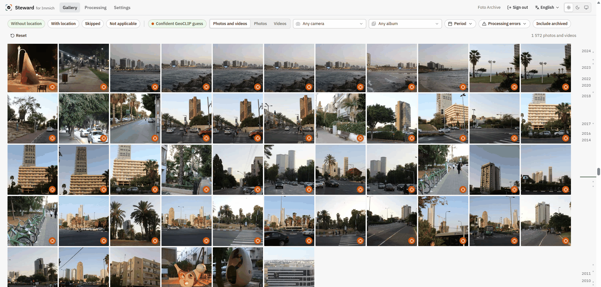
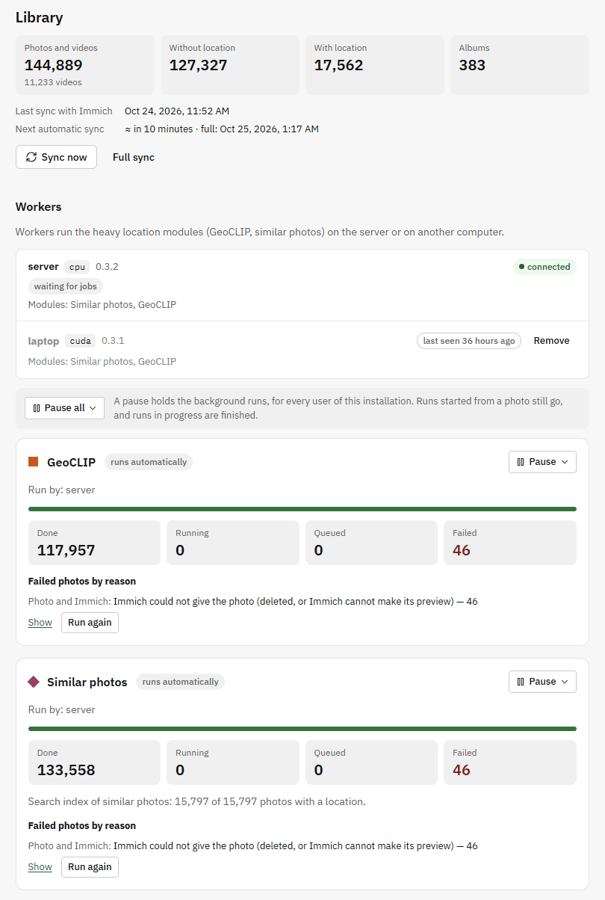

<p align="center">
  
</p>

<h1 align="center">Steward for Immich</h1>

<p align="center">
  Bring deine Fotos ohne GPS zurück auf die Karte — mehrere unabhängige Hinweise, eine Karte, du entscheidest.
</p>

<p align="center">
  <a href="https://github.com/Ivamic/immich-steward/releases"></a>
  <a href="https://github.com/Ivamic/immich-steward/actions/workflows/ci.yml"></a>
  <a href="LICENSE"></a>
  
</p>

<p align="center">
  <a href="README.md">English</a> · <b>Deutsch</b> · <a href="README.fr.md">Français</a> · <a href="README.it.md">Italiano</a> · <a href="README.ru.md">Русский</a>
</p>

<p align="center">
  
</p>

> Dies ist eine mit Hilfe von KI erstellte Übersetzung der [englischen README](README.md), die
> maßgeblich bleibt. Die Dokumentation und der Teil für Entwickler sind vorerst nur auf Englisch.
> Verbesserungen der Übersetzung sind sehr willkommen.

> [!IMPORTANT]
> **Update auf 0.6 von 0.5 oder älter: ein Schritt von Hand, einmalig.**
>
> **Warum.** Bis 0.5 nannte `compose.yaml` die genaue Version der App, darum brauchte jedes
> Update auch `git pull`. Ab 0.6 folgt `compose.yaml` der Hauptversion und liest alle
> Einstellungen aus `.env`: Die Datei bleibt gleich, und jedes weitere Update ist nur noch
> `docker compose pull` und `docker compose up -d`.
>
> **Wie.** Im Ordner der App; deine `.env` und deine Daten bleiben, wie sie sind.
>
> Ohne Worker:
>
> ```sh
> curl -L -o compose.yaml https://github.com/Ivamic/immich-steward/releases/latest/download/compose.yaml
> docker compose pull
> docker compose up -d
> ```
>
> Mit dem Worker auf dem Server:
>
> ```sh
> curl -L -o compose.yaml https://github.com/Ivamic/immich-steward/releases/latest/download/compose.yaml
> docker compose --profile worker pull
> docker compose --profile worker up -d
> ```
>
> Steht in `.env` eine Zeile `STEWARD_VERSION=…`, entferne sie vorher: Sie würde die alte Version festhalten. [Details](docs/updating.md#coming-from-05-or-older) (Englisch).

> **Status: in aktiver Entwicklung.** Eine frühe Version: Die Durchsicht von Fotos ohne Standort,
> Vorschläge aus zeitlich nahen Fotos, GeoCLIP und ähnliche Fotos deiner eigenen Mediathek
> funktionieren bereits; die anderen Module folgen noch. Rechne mit Fehlern und Änderungen
> zwischen den Versionen und lege eine Sicherung deiner Immich-Mediathek an, bevor du Standorte
> hineinschreibst.

Eine selbst gehostete Begleit-App für [Immich](https://immich.app). Für jedes Foto ohne Standort
schlagen mehrere Module — zeitlich nahe Fotos, das neuronale Netz GeoCLIP und ähnliche Fotos
desselben Ortes aus deiner eigenen Mediathek — vor, wo es aufgenommen wurde, alle auf einer
Karte. Du wählst mit einem Klick oder einer Taste oder setzt den Standort vieler Fotos auf
einmal. In Immich wird nichts geschrieben, bevor du das tust, und jede Änderung lässt sich
rückgängig machen.

Typischer Fall: ein Familienfotoarchiv mit eingescannten Abzügen, alten Digitalkameras ohne GPS
oder Downloads aus Messengern, die ihre Metadaten verloren haben.

## Idee

Die App vereint mehrere unabhängige **Module zur Standortbestimmung**. Jedes Modul schlägt einen
oder mehrere mögliche Orte vor, und alle Vorschläge werden zusammen auf einer Karte gezeigt,
farblich nach Modul und nummeriert nach Rang. Du siehst sie dir an, wählst einen aus oder setzt
einen Punkt von Hand.

Verfügbare Module:

- **Zeitliche Nachbarn** — kurz davor und danach aufgenommene Fotos, die schon einen Standort
  haben. Die Route zwischen ihnen wird auf der Karte gezeichnet, nach Zeit eingefärbt; Kameras
  mit falsch gehender Uhr lassen sich ausschließen, oder nur die Kamera des Fotos behalten.
- **GeoCLIP** *(optionaler Worker)* — weltweite Bild-Geolokalisierung durch ein neuronales Netz,
  lokal auf der CPU des Servers oder auf der GPU eines anderen Computers. Mit Konfidenz
  angezeigt, mit einem Galeriefilter für seine sicheren Schätzungen. Es kann sich auch nur einen
  Teil des Fotos ansehen: ein Gebäude hinter einer Menschenmenge, ein Schild, einen Berg am
  Horizont.
- **Ähnliche Fotos** *(optionaler Worker)* — Fotos desselben Ortes aus deiner eigenen Mediathek,
  mit Standort: dieselbe Straße, dasselbe Haus, derselbe Blick oder Raum, aus einem anderen
  Winkel oder zu einer anderen Jahreszeit. Nutzt [MegaLoc](https://github.com/gmberton/MegaLoc),
  ein Modell zum Wiedererkennen von Orten; in einer echten Familienmediathek liegt etwa die
  Hälfte seiner Vorschläge auf 1 km genau richtig, bei den sicheren mehr als acht von zehn. Die
  Suche berücksichtigt immer auch die Standorte, die du inzwischen gesetzt hast.

Ein Foto lässt sich in der App drehen, um es besser zu sehen; die Module arbeiten mit dem
gedrehten Foto, und die Drehung kann in Immich gespeichert werden.

Um einen Ort mit eigenen Augen zu prüfen, lassen sich Satellitenbilder unter der Karte
anzeigen: Sentinel-2 von EOX (ohne Schlüssel), Esri World Imagery oder MapTiler Satellite (mit
eigenem Schlüssel). Alle sind aus, bis du einen einschaltest.

Die Galerie zeigt deine Fotos nach Monat und Tag und markiert die mit einer leichten Antwort: ein
Foto mit Standort wenige Minuten davor oder danach, eine sichere GeoCLIP-Schätzung, ein ähnliches
Foto mit Standort. Videos spielen in der Galerie und in der Fotokarte. Alles funktioniert auch
auf dem Handy.

**Gruppen** fassen Fotos derselben Ansicht von selbst zusammen, mit und ohne Standort: Liegen die
Fotos mit Standort an einer Stelle, lässt sich dieser Ort in einem Schritt auf die übrigen
übertragen, nachdem du ihn auf der Karte geprüft hast. Was im Lauf der Jahre umgezogen ist, zeigt
sich Monat für Monat, eine unpassende Stelle fällt auf, und Fotos ohne Ortsmerkmale (ein Haustier,
ein Dokument) lassen sich markieren, damit sie nichts vorschlagen.

Geplant:

- **Straßenpanoramen** auf der Karte, um einen Ort mit eigenen Augen zu prüfen.
- **Geometrische Prüfung** ähnlicher Fotos (übereinstimmende Details, nicht nur der
  Gesamteindruck) und das automatische Erkennen von Fotos, die gar keinen Ort zeigen:
  Nahaufnahmen von Personen, Haustiere, Pflanzen, Gegenstände.
- **Schlussfolgern mit einem LLM** (im Stil von Img2Loc) — ein Bild-Sprach-Modell denkt über das
  Foto und die von den anderen Modulen gesammelten Hinweise nach.
- **Externe Dienste** — optionale Cloud-Erkennung, ein Modul pro Dienst.

Neue Module können später als Plugins hinzukommen.

## Screenshots

<table>
  <tr>
    <td width="50%"></td>
    <td width="50%"></td>
  </tr>
  <tr>
    <td>GeoCLIP erkennt den Ort allein am Bild: eine sichere Schätzung für eine Kamera ohne GPS (dunkles Design).</td>
    <td>Mehrere Module zugleich: das GeoCLIP-Gebiet, ein zwei Stunden später aufgenommenes Handyfoto und ähnliche Fotos stimmen in der Stadt überein.</td>
  </tr>
  <tr>
    <td colspan="2"></td>
  </tr>
  <tr>
    <td colspan="2">Die Galerie: Filter als Chips, ein Abzeichen auf jedem Foto mit Standort oder sicherer Schätzung, rechts die Zeitleiste.</td>
  </tr>
  <tr>
    <td width="50%"></td>
    <td>Verarbeitung: die Mediathek und ihre Synchronisierung, die Worker und was sie tun, Fortschritt und Fehler jedes Moduls, mit einer Pause für die Hintergrundläufe.</td>
  </tr>
</table>

## Grundsätze

- **Nichts wird automatisch in Immich geschrieben.** Koordinaten werden erst gesendet, nachdem du
  einen Standort bestätigt hast. Jede Änderung lässt sich rückgängig machen.
- **Lokal zuerst.** Die Standardmodule laufen auf deiner eigenen Hardware. Module, die Bilder an
  Dienste Dritter senden, laufen nie automatisch — nur auf ausdrücklichen Wunsch, mit einem
  klaren Hinweis, was wohin gesendet wird.
- **Suche in einem Bildbereich.** Führt das ganze Bild in die Irre (zum Beispiel eine
  Menschenmenge vor einem Denkmal), wähle einen Teil des Bildes und führe die Erkennung nur
  darauf aus.
- **Markierung „Kein Standort sinnvoll“.** Markiere Fotos, bei denen ein Standort keinen Sinn
  ergibt, damit sie nie wieder in deiner Aufgabenliste auftauchen.

## Installation

Steward läuft mit Docker Compose neben deinem Immich-Server (Immich v3.x):

```sh
mkdir immich-steward && cd immich-steward
curl -L -o compose.yaml https://github.com/Ivamic/immich-steward/releases/latest/download/compose.yaml
curl -L -o example.env https://github.com/Ivamic/immich-steward/releases/latest/download/example.env
cp example.env .env      # STEWARD_IMMICH_URL, STEWARD_SECRET_KEY und DB_PASSWORD setzen
docker compose up -d
```

Die Images werden aus der GitHub Container Registry geladen (`ghcr.io/ivamic/immich-steward-core`,
`amd64` und `arm64`); sie lassen sich auch
[aus dem Quellcode bauen](docs/updating.md#building-the-images-from-source). Aktualisieren:
`docker compose pull && docker compose up -d`.

Öffne dann `http://<dein-server>:8780` und melde dich mit deinem Immich-Konto an.

GeoCLIP und ähnliche Fotos laufen in einem optionalen Worker-Container (2 bis 4 GB RAM, wenn
beide Modelle geladen sind): Setze `STEWARD_WORKER_TOKEN` in `.env` und starte mit
`docker compose --profile worker up -d`.
Worker können auch auf anderen Computern in deinem Netzwerk laufen: **Verarbeitung → Gerät
hinzufügen** zeigt die Befehle zum Kopieren ([mehr](docs/workers.md#a-worker-on-another-computer)).

Die [Dokumentation](docs/README.md) (auf Englisch) erklärt alles Schritt für Schritt:
[Installation](docs/install.md), [Nutzung der App](docs/usage.md), [Worker](docs/workers.md),
[Konfiguration](docs/configuration.md), [Aktualisierung](docs/updating.md),
[Datenschutz](docs/privacy.md) und [Fehlerbehebung](docs/troubleshooting.md).

## Feedback und Mitwirken

- **Fehler** — eröffne ein [Issue](https://github.com/Ivamic/immich-steward/issues) mit den
  Versionen von Steward und Immich und den Schritten zum Nachstellen.
- **Ideen und Fragen** — starte einen Thread in
  [Discussions](https://github.com/Ivamic/immich-steward/discussions). Berichte, wie du die App
  nutzt und bei welchen Fotos sie scheitert, sind ebenfalls willkommen.
- **Pull Requests** sind willkommen. Bei allem, was über eine kleine Korrektur hinausgeht,
  besprich es bitte zuerst in einem Issue oder einer Diskussion, damit deine Arbeit zu den Plänen
  des Projekts passt.
- **Sicherheitsprobleme** — bitte vertraulich melden, siehe [SECURITY.md](SECURITY.md).

Schreib am besten auf Englisch; wenn das schwerfällt, geht auch Deutsch.

## Das Projekt unterstützen

Steward ist kostenlos und wird in der Freizeit entwickelt. Wenn es dir Stunden manueller
Verschlagwortung erspart hat, kannst du die Entwicklung mit einer Spende in Kryptowährung
unterstützen. Ein Stern für das Repository, Fehlermeldungen und das Weitererzählen helfen
ebenfalls.

| Währung | Netzwerk | Adresse |
|---|---|---|
| USDT | TRON (TRC-20) | `TAqGEvmDTw2ro4BKQmcPPtqK5xEMfNaiSX` |
| ETH, USDT und andere Token | Ethereum und EVM-Netzwerke (Base, Polygon, Arbitrum…) | `0x783C192d69fE5E9DAfa1dC2c41FeE272122AE031` |
| SOL | Solana | `38gidbL2ocv5c6CK7zP7c3QWVHisYyqhnrMV3tuaYpgp` |
| BTC | Bitcoin | `bc1qsdys5hvx7vlxp25mz77hfgz2l35x8klc8z2npx` |

Prüfe vor dem Senden bitte das Netzwerk: Über ein anderes Netzwerk gesendete Beträge können
verloren gehen.

## Lizenz

Copyright (C) 2026 Ivamic.

[GNU Affero General Public License v3.0 oder später](LICENSE) (`AGPL-3.0-or-later`).

**Name und Logo.** Der Name „Steward for Immich“ und sein Logo stehen nicht unter der AGPL; alle
Rechte liegen beim Autor, Einzelheiten in der [englischen README](README.md#license). Du darfst
sie verwenden, um auf dieses Projekt zu verweisen. Forks und veränderte Versionen müssen einen
anderen Namen und ein anderes Logo verwenden.

## KI-Unterstützung

Dieses Projekt wird mit Hilfe von KI-Werkzeugen (Claude von Anthropic) entwickelt. Der gesamte
Code wird von einem menschlichen Autor geprüft und gepflegt.

## Hinweis

Dies ist ein unabhängiges Community-Projekt. Es steht in keiner Verbindung zum Projekt Immich
oder zu FUTO und wird von ihnen nicht unterstützt.
