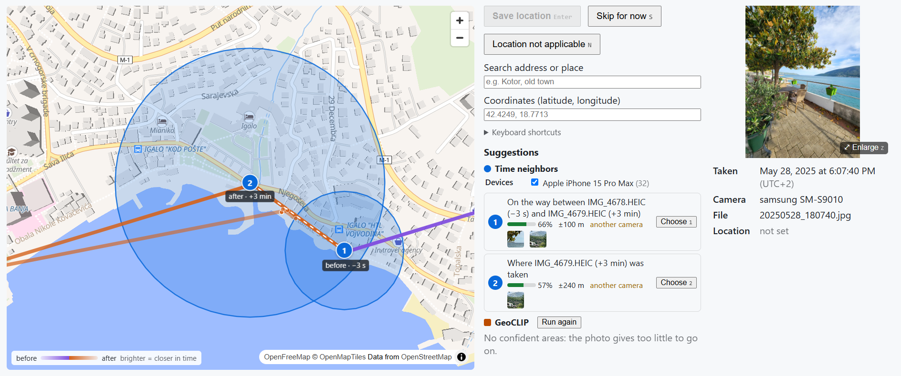
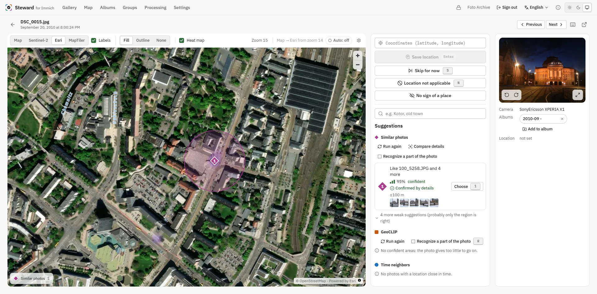
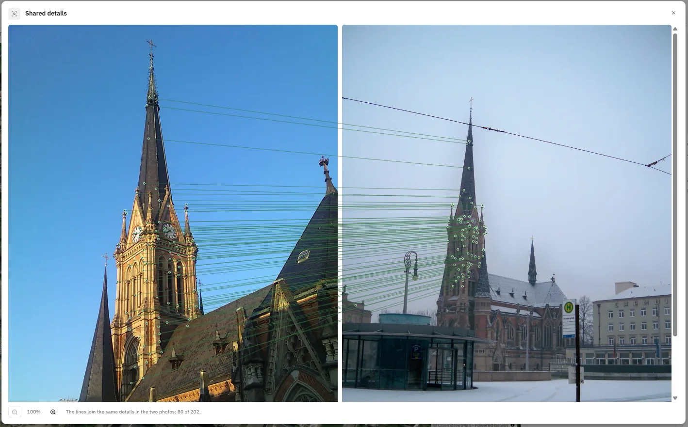
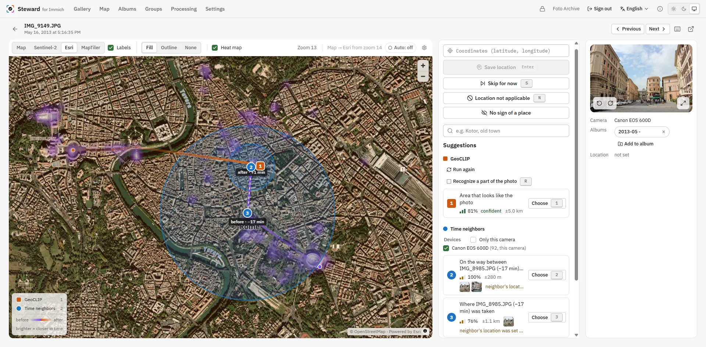
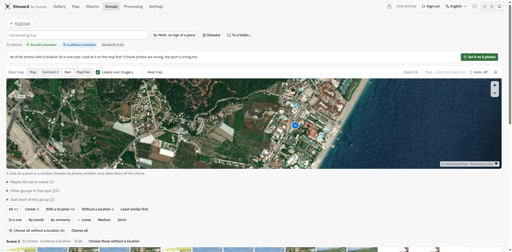
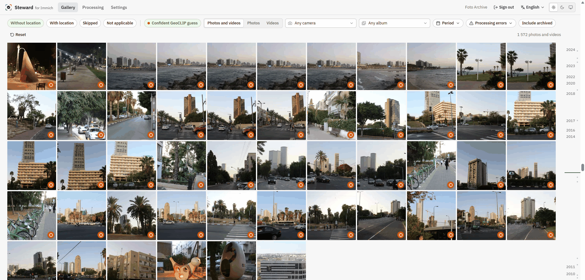
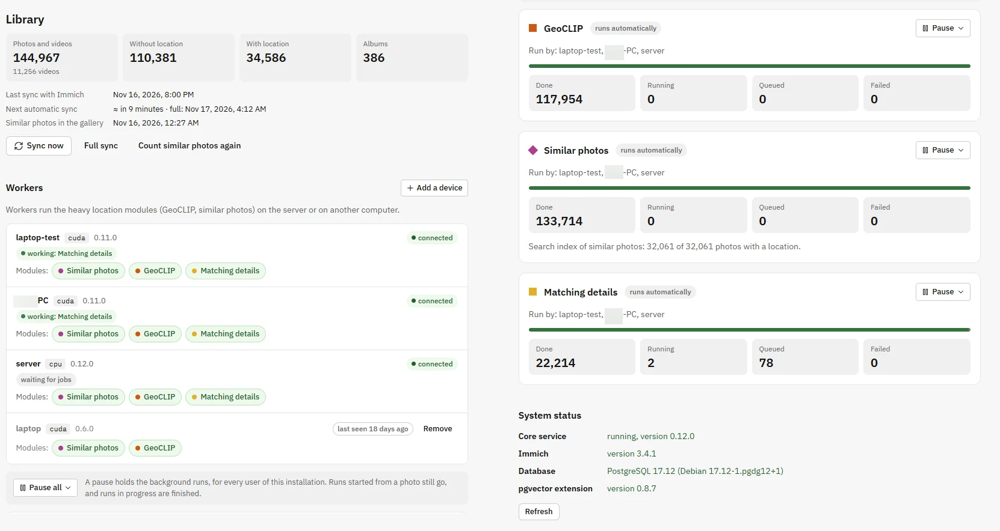

<p align="center">
  
</p>

<h1 align="center">Steward for Immich</h1>

<p align="center">
  Remettez vos photos sans GPS sur la carte — plusieurs indices indépendants, une seule carte, à vous de choisir.
</p>

<p align="center">
  <a href="https://github.com/Ivamic/immich-steward/releases"></a>
  <a href="https://github.com/Ivamic/immich-steward/actions/workflows/ci.yml"></a>
  <a href="LICENSE"></a>
  
</p>

<p align="center">
  <a href="README.md">English</a> · <a href="README.de.md">Deutsch</a> · <b>Français</b> · <a href="README.it.md">Italiano</a> · <a href="README.ru.md">Русский</a>
</p>

<p align="center">
  
</p>

> Ceci est une traduction, réalisée avec l'aide de l'IA, du [README anglais](README.md), qui fait
> foi. La documentation et la partie pour les développeurs ne sont pour l'instant qu'en anglais.
> Les corrections de la traduction sont les bienvenues.

> [!IMPORTANT]
> **Passer à la 0.6 depuis la 0.5 ou plus ancienne : une étape à la main, une seule fois.**
>
> **Pourquoi.** Jusqu'à la 0.5, `compose.yaml` indiquait la version exacte de l'application,
> donc chaque mise à jour demandait aussi `git pull`. À partir de la 0.6, `compose.yaml` suit la
> version majeure et lit tous les réglages dans `.env` : il ne change plus, et chaque mise à jour
> se résume à `docker compose pull` et `docker compose up -d`.
>
> **Comment.** Dans le dossier de l'application ; votre `.env` et vos données restent tels quels.
>
> Sans le worker :
>
> ```sh
> curl -L -o compose.yaml https://github.com/Ivamic/immich-steward/releases/latest/download/compose.yaml
> docker compose pull
> docker compose up -d
> ```
>
> Avec le worker sur le serveur :
>
> ```sh
> curl -L -o compose.yaml https://github.com/Ivamic/immich-steward/releases/latest/download/compose.yaml
> docker compose --profile worker pull
> docker compose --profile worker up -d
> ```
>
> Si `.env` contient une ligne `STEWARD_VERSION=…`, supprimez-la d'abord : elle garderait l'ancienne version. [Détails](docs/updating.md#coming-from-05-or-older) (en anglais).

> **Statut : en développement actif.** Une première version : la revue des photos sans lieu, les
> suggestions tirées des photos proches dans le temps, GeoCLIP et les photos similaires de votre
> propre photothèque fonctionnent déjà ; les autres modules sont encore à venir. Attendez-vous à
> des bugs et à des changements entre les versions, et faites une sauvegarde de votre photothèque
> Immich avant d'y écrire des lieux.

Une application compagnon auto-hébergée pour [Immich](https://immich.app). Pour chaque photo sans
lieu, plusieurs modules — les photos prises peu avant et peu après, le réseau neuronal GeoCLIP
et les photos similaires du même endroit dans votre propre photothèque — proposent où elle a
été prise, tous sur une seule carte. Vous choisissez d'un clic ou d'une touche, ou indiquez le
lieu de nombreuses photos d'un coup. Rien n'est écrit dans Immich avant que vous ne le fassiez,
et chaque modification peut être annulée.

Cas typique : des archives photo familiales avec des tirages numérisés, de vieux appareils
numériques sans GPS ou des photos reçues par messagerie qui ont perdu leurs métadonnées.

## Le principe

### Trouver le lieu

L'application réunit plusieurs **modules de localisation** indépendants. Chaque module propose un
ou plusieurs lieux possibles, et toutes les propositions sont affichées ensemble sur une carte,
avec une couleur par module et un numéro selon leur rang. Vous les examinez, en choisissez une
ou placez un point à la main.

Modules disponibles :

- **Voisines dans le temps** — les photos prises juste avant et juste après qui ont déjà un lieu.
  Le trajet entre elles est tracé sur la carte, coloré selon le temps ; les appareils dont
  l'horloge est fausse peuvent être exclus, ou seul l'appareil de la photo gardé.
- **GeoCLIP** *(worker facultatif)* — géolocalisation d'images dans le monde entier par un réseau
  de neurones, en local sur le processeur du serveur ou sur la carte graphique d'un autre
  ordinateur. Affiché avec un niveau de confiance, avec un filtre de galerie pour ses estimations
  sûres. Il peut aussi n'examiner qu'une partie de la photo : un bâtiment derrière une foule, une
  enseigne, une montagne à l'horizon.
- **Photos similaires** *(worker facultatif)* — des photos du même endroit dans votre propre
  photothèque, avec un lieu : la même rue, la même maison, la même vue ou la même pièce, sous un
  autre angle ou à une autre saison. Utilise [MegaLoc](https://github.com/gmberton/MegaLoc), un
  modèle conçu pour reconnaître les lieux ; sur une vraie photothèque familiale, environ la
  moitié de ses suggestions sont justes à 1 km près, et plus de huit sur dix de ses suggestions
  sûres. La confiance d'une suggestion dépend aussi de la distance entre les photos les plus
  similaires. La recherche tient toujours compte des lieux que vous avez définis entre-temps.
- **Comparaison des détails** *(worker facultatif)* — regarde de plus près ce que les photos
  similaires ont trouvé : elle compare la photo point par point avec les plus ressemblantes
  ([ALIKED](https://github.com/Shiaoming/ALIKED) et
  [LightGlue](https://github.com/cvg/LightGlue)). Une suggestion dont la photo partage une
  centaine de détails avec la vôtre est marquée comme confirmée et affichée en premier : sur
  une vraie photothèque familiale, une telle suggestion était juste à 1 km près 95 fois sur
  100. Un clic montre les deux photos côte à côte, avec des lignes entre les détails communs.

Pour vérifier un lieu de ses propres yeux, des images satellite peuvent être affichées sous la
carte : Sentinel-2 d'EOX (sans clé), Esri World Imagery ou MapTiler Satellite (avec votre propre
clé). Toutes sont désactivées tant que vous n'en activez pas une.

**Images de rue** *(bêta)* : des photos de la rue prises par d'autres, depuis
[Panoramax](https://panoramax.fr) et [Mapillary](https://www.mapillary.com) (avec votre propre
jeton), à moins de 100 m du point, dans un bandeau sous la carte. Seules les coordonnées du point
leur sont envoyées, et seulement une fois une source activée. Un worker les compare avec votre
photo : celles qui montrent la même scène passent en premier, avec des lignes entre les détails
communs, et l'application en déduit la direction de l'appareil, affichée en cône sur la carte.
Votre photo reste chez vous.

**Les groupes** rassemblent d'eux-mêmes les photos d'une même vue, avec ou sans lieu : quand les
photos avec un lieu se trouvent au même endroit, ce lieu s'applique aux autres en une fois, après
un coup d'œil sur la carte. Un sujet qui a changé d'endroit au fil des ans se voit mois par mois,
un endroit qui ne colle pas saute aux yeux, et les groupes d'un même lieu se rangent ensemble dans
un dossier. Les photos sans indice de lieu (un animal, un document) peuvent être marquées pour ne
plus rien suggérer ; l'application marque aussi celles qui ressemblent à vos marques et en trouve
d'autres à examiner, d'après une description, grâce à la recherche intelligente d'Immich.

La galerie montre vos photos par mois et par jour et marque celles dont la réponse est facile :
une photo avec un lieu prise quelques minutes avant ou après, une estimation GeoCLIP sûre, une
photo similaire avec un lieu. Les vidéos se lisent dans la galerie et dans la fiche photo. Tout
fonctionne aussi sur un téléphone.

La page **Carte** montre vos photos avec un lieu, comptées par endroit sur le serveur ; de près, les
endroits montrent une photo, et les photos à l'écran sont listées à côté de la carte.

### Travailler les photos

Une photo peut être pivotée dans l'application pour mieux la voir ; les modules travaillent sur
la photo pivotée, et la rotation peut être enregistrée dans Immich. Les photos couchées sur le
côté sont trouvées par un module de worker et listées ensemble (avec, au choix, leur aspect une
fois redressées), pour les tourner dans Immich en une seule étape.

Les **albums** d'Immich se remplissent depuis la galerie : choisissez des photos avec n'importe
quels filtres et dans l'ordre voulu (toutes les vidéos de quelques années, les plus anciennes
d'abord) et ajoutez-les à un album, existant ou nouveau, en une étape qui peut être annulée. La
page **Albums** montre vos albums et ceux partagés avec vous ; un album s'ouvre dans la galerie
avec tous ses filtres, et les vôtres peuvent être renommés ou supprimés.

### Et aussi

Les photos du **dossier verrouillé** d'Immich peuvent aussi en profiter : connecté une fois avec
votre mot de passe Immich, le dossier s'ouvre dans l'application avec votre code PIN ; ses photos ne
sont affichées et traitées que tant qu'il est ouvert. Tout point s'ouvre d'un clic dans **Google
Maps** (satellite ou Street View).

### Prévu

- **L'endroit exact de la prise de vue**, d'après les images de rue concordantes : là où leurs
  directions se croisent.
- **Raisonnement par LLM** (dans l'esprit d'Img2Loc) — un modèle vision-langage raisonne sur la
  photo et sur les indices rassemblés par les autres modules.
- **Services externes** — des services de reconnaissance en ligne facultatifs, un module par
  service.

De nouveaux modules pourront être ajoutés plus tard sous forme d'extensions.

## Captures d'écran

<table>
  <tr>
    <td width="50%"></td>
    <td width="50%"></td>
  </tr>
  <tr>
    <td>Les photos semblables de votre propre photothèque trouvent le lieu, et la comparaison des détails le confirme : une photo de nuit d'un opéra, sans GPS.</td>
    <td>Pourquoi c'est sûr : les détails que partagent les deux photos, reliés par des lignes, d'une saison et d'un appareil à l'autre.</td>
  </tr>
  <tr>
    <td width="50%"></td>
    <td width="50%"></td>
  </tr>
  <tr>
    <td>Plusieurs modules à la fois : la zone GeoCLIP, le trajet entre les photos prises avant et après, et la carte de chaleur des lieux proches.</td>
    <td>Les groupes : les photos d'une même vue se rassemblent d'elles-mêmes ; quand celles qui ont un lieu concordent, les autres le reçoivent en une étape.</td>
  </tr>
  <tr>
    <td colspan="2"></td>
  </tr>
  <tr>
    <td colspan="2">La galerie : des filtres en pastilles, un badge sur chaque photo qui a un lieu ou une estimation sûre, la frise chronologique à droite.</td>
  </tr>
  <tr>
    <td colspan="2"></td>
  </tr>
  <tr>
    <td colspan="2">Traitement : la photothèque et sa synchronisation, les workers et ce qu'ils font, l'avancement de chaque module, avec une pause pour les traitements en arrière-plan.</td>
  </tr>
</table>

## Principes

- **Rien n'est écrit automatiquement dans Immich.** Les coordonnées ne sont envoyées qu'après
  que vous avez confirmé un lieu, et les albums ne changent que sur votre clic. Toute modification
  peut être annulée.
- **Le local d'abord.** Les modules par défaut fonctionnent sur votre propre matériel. Les modules
  qui envoient des images à des services tiers ne sont jamais lancés automatiquement — seulement
  sur demande explicite, avec un avertissement clair sur ce qui est envoyé et où.
- **Recherche sur une zone.** Si l'image entière est trompeuse (par exemple une foule devant un
  monument), sélectionnez une partie de l'image et lancez la détection sur cette zone seulement.
- **Marque « Lieu sans objet ».** Marquez les photos pour lesquelles un lieu n'a pas de sens, afin
  qu'elles ne réapparaissent plus jamais dans votre liste à traiter.

## Installation

Steward fonctionne avec Docker Compose à côté de votre serveur Immich (Immich v3.x) :

```sh
mkdir immich-steward && cd immich-steward
curl -L -o compose.yaml https://github.com/Ivamic/immich-steward/releases/latest/download/compose.yaml
curl -L -o example.env https://github.com/Ivamic/immich-steward/releases/latest/download/example.env
cp example.env .env      # définir STEWARD_IMMICH_URL, STEWARD_SECRET_KEY et DB_PASSWORD
docker compose up -d
```

Les images sont téléchargées depuis GitHub Container Registry
(`ghcr.io/ivamic/immich-steward-core`, `amd64` et `arm64`) ; on peut aussi les
[construire à partir des sources](docs/updating.md#building-the-images-from-source). Mettre à
jour : `docker compose pull && docker compose up -d`.

Ouvrez ensuite `http://<votre-serveur>:8780` et connectez-vous avec votre compte Immich.

GeoCLIP et les photos similaires tournent dans un conteneur worker facultatif (2 à 4 Go de RAM
avec les deux modèles chargés) : définissez `STEWARD_WORKER_TOKEN` dans `.env` et lancez
`docker compose --profile worker up -d`.
Les workers peuvent aussi tourner sur d'autres ordinateurs de votre réseau : **Traitement →
Ajouter un appareil** montre les commandes à copier ([plus](docs/workers.md#a-worker-on-another-computer)).

La [documentation](docs/README.md) (en anglais) explique tout pas à pas :
[installation](docs/install.md), [utilisation](docs/usage.md), [workers](docs/workers.md),
[configuration](docs/configuration.md), [mise à jour](docs/updating.md),
[confidentialité](docs/privacy.md) et [dépannage](docs/troubleshooting.md).

## Retours et contributions

- **Bugs** — ouvrez une [issue](https://github.com/Ivamic/immich-steward/issues) en indiquant les
  versions de Steward et d'Immich et les étapes pour reproduire le problème.
- **Idées et questions** — lancez une discussion dans
  [Discussions](https://github.com/Ivamic/immich-steward/discussions). Les récits sur votre façon
  d'utiliser l'application et sur les photos où elle échoue sont aussi les bienvenus.
- **Les pull requests** sont les bienvenues. Pour tout ce qui dépasse une petite correction,
  parlez-en d'abord dans une issue ou une discussion, afin que votre travail s'inscrive dans les
  projets du dépôt.
- **Problèmes de sécurité** — merci de les signaler en privé, voir [SECURITY.md](SECURITY.md).

Écrivez de préférence en anglais ; si c'est difficile, le français convient aussi.

## Soutenir le projet

Steward est gratuit et développé sur le temps libre. S'il vous a épargné des heures de
classement à la main, vous pouvez soutenir son développement par un don en cryptomonnaie. Une
étoile sur le dépôt, des rapports de bugs et parler du projet autour de vous aident aussi.

| Monnaie | Réseau | Adresse |
|---|---|---|
| USDT | TRON (TRC-20) | `TAqGEvmDTw2ro4BKQmcPPtqK5xEMfNaiSX` |
| ETH, USDT et autres jetons | Ethereum et réseaux EVM (Base, Polygon, Arbitrum…) | `0x783C192d69fE5E9DAfa1dC2c41FeE272122AE031` |
| SOL | Solana | `38gidbL2ocv5c6CK7zP7c3QWVHisYyqhnrMV3tuaYpgp` |
| BTC | Bitcoin | `bc1qsdys5hvx7vlxp25mz77hfgz2l35x8klc8z2npx` |

Vérifiez bien le réseau avant l'envoi : des fonds envoyés sur un autre réseau peuvent être
perdus.

## Licence

Copyright (C) 2026 Ivamic.

[GNU Affero General Public License v3.0 ou ultérieure](LICENSE) (`AGPL-3.0-or-later`).

**Nom et logo.** Le nom « Steward for Immich » et son logo ne sont pas placés sous l'AGPL ; tous
les droits sont réservés à l'auteur, détails dans le [README anglais](README.md#license). Vous
pouvez les utiliser pour faire référence à ce projet. Les forks et les versions modifiées doivent
utiliser un autre nom et un autre logo.

## Assistance de l'IA

Ce projet est développé avec l'aide d'outils d'IA (Claude d'Anthropic). Tout le code est relu et
maintenu par un auteur humain.

## Avertissement

Ceci est un projet communautaire indépendant. Il n'est ni affilié au projet Immich ou à FUTO, ni
approuvé par eux.
