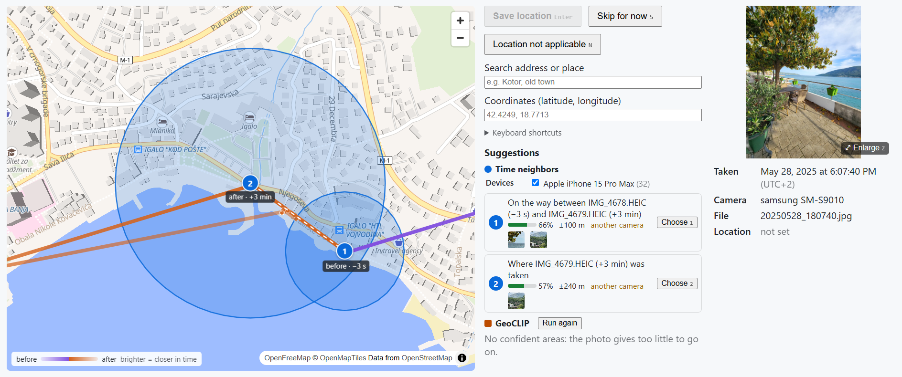
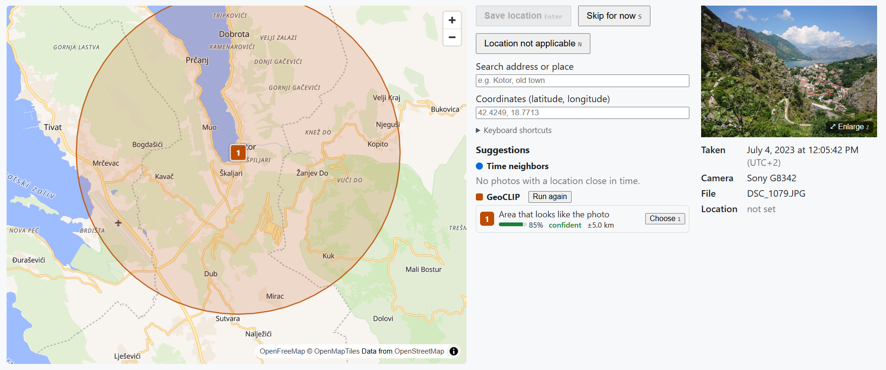
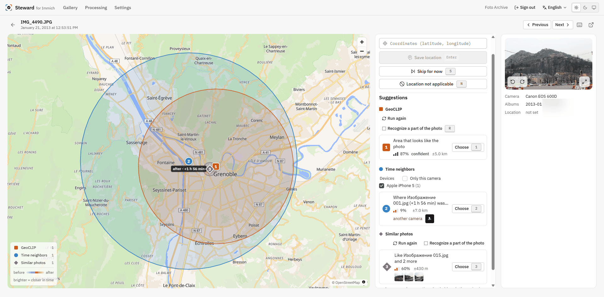

<p align="center">
  
</p>

<h1 align="center">Steward for Immich</h1>

<p align="center">
  Find out where your photos without GPS were taken — and write it back to <a href="https://immich.app">Immich</a> only when you say so.
</p>

<p align="center">
  <a href="https://github.com/Ivamic/immich-steward/releases"></a>
  <a href="https://github.com/Ivamic/immich-steward/actions/workflows/ci.yml"></a>
  <a href="LICENSE"></a>
  
</p>

<p align="center">
  
</p>

> **Status: under active development.** An early version: reviewing photos without a location,
> suggestions from photos taken close in time, GeoCLIP and similar photos of your own library
> already work; the other modules are still to come. Expect bugs and changes between versions, and keep a backup of your Immich
> library before writing locations to it.

A self-hosted companion app for [Immich](https://immich.app) that helps you restore
missing information in your photo library — and lets *you* decide what is written back.

The first tool finds out **where photos without GPS data were taken**.

Typical use case: a family photo archive with scanned prints, old digital cameras
without GPS, or messenger downloads that lost their metadata.

## Idea

The app combines several independent **location detection modules**. Each module
proposes one or more candidate locations, and all candidates are shown together on a
map, color-coded by module and numbered by rank. You review them, pick one, or place a
point manually.

Available modules:

- **Time neighbors** — photos taken shortly before and after that already have a location. The
  route between them is drawn on the map, colored by time; cameras with a wrong clock can be
  excluded, or only the photo's own camera kept.
- **GeoCLIP** *(optional worker)* — worldwide image geolocation by a neural network, running
  locally on the server CPU or on a GPU of another computer. Shown by confidence, with a gallery
  filter for its confident guesses. It can also look at a part of the photo only: a building
  behind a crowd, a sign, a mountain on the horizon.
- **Similar photos** *(optional worker)* — photos of the same place in your own library, with a
  location: the same street, house, view or room, from another angle or in another season. Uses
  [MegaLoc](https://github.com/gmberton/MegaLoc), a model made for recognizing places; on a real
  family library, about half of its suggestions are right within 1 km, and more than eight
  out of ten of its confident ones. The search always includes the locations you have set since.

A photo can be rotated in the app for a better look, the modules run on it rotated, and the
rotation can be saved to Immich.

Planned:

- **Satellite imagery and street-level panoramas** on the map, to check a place by eye.
- **Geometric verification** of similar photos (matching details, not only the overall look),
  and telling apart photos that show no place at all: close-up portraits, pets, plants, objects.
- **LLM reasoning** (Img2Loc-style) — a vision-language model reasons over the photo
  plus the evidence collected by the other modules.
- **External services** — optional cloud recognizers, one module per service.

New modules can be added later as plugins.

## Screenshots

<table>
  <tr>
    <td width="50%"></td>
    <td width="50%"></td>
  </tr>
  <tr>
    <td>GeoCLIP recognizes the place from the image alone: a confident guess for a camera without GPS.</td>
    <td>Several modules at once: a phone photo taken two hours later and the GeoCLIP area agree on the city.</td>
  </tr>
</table>

## Principles

- **Nothing is written to Immich automatically.** Coordinates are sent only after you
  confirm a location. Every change can be undone.
- **Local first.** Default modules run on your own hardware. Modules that send images
  to third-party services are never run automatically — only on an explicit request,
  with a clear warning about what is sent and where.
- **Region-based search.** If the whole picture is misleading (for example, a crowd in front
  of a monument), select a part of the image and run detection on that region only.
- **"Not applicable" flag.** Mark photos where a location makes no sense, so they never
  show up in your to-do list again.

## Installation

Steward runs with Docker Compose next to your Immich server (Immich v3.x):

```sh
git clone https://github.com/Ivamic/immich-steward.git
cd immich-steward
cp .env.example .env      # set STEWARD_IMMICH_URL, STEWARD_SECRET_KEY and DB_PASSWORD
docker compose up -d
```

The images are pulled from GitHub Container Registry (`ghcr.io/ivamic/immich-steward-core`,
`amd64` and `arm64`); add `--build` to build them from source instead.

Then open `http://<your-server>:8780` and sign in with your Immich account.

GeoCLIP and similar photos run in an optional worker container (2 to 4 GB of RAM with both
models loaded): set `STEWARD_WORKER_TOKEN` in `.env` and start with
`docker compose --profile worker up -d`.
Workers can also run on other computers in your network
([how](docs/install.md#workers-on-other-computers)).

See [docs/install.md](docs/install.md) for the details: configuration, the worker, Immich
on the same machine, updating, backup and troubleshooting.

## Architecture

- Backend: Python (FastAPI), PostgreSQL with pgvector.
- Runs with Docker Compose next to your Immich server.
- ML modules run in workers: separate processes that take jobs from the core over HTTP, on the
  server CPU or on another computer with a GPU. Workers never see an Immich API key: the core
  gives them the photos.
- Web UI: timeline gallery with filters, photo view with a map, keyboard-driven review.
- English UI with translations (Russian from the start).

## Development

Repository layout:

| Path | Contents |
|---|---|
| `core/` | Core service: Python package `steward` (FastAPI), Alembic migrations, tests |
| `worker/` | Worker: Python package `steward_worker` that runs ML location modules (GeoCLIP, similar photos) |
| `frontend/` | Web UI: SvelteKit single-page app; translations in `frontend/messages/` |
| `docker/` | Dockerfiles of the core image (with the built web UI) and of the worker image (CPU); `.github/workflows/release.yml` publishes them for every version tag |
| `compose.yaml` | Core service, PostgreSQL with pgvector, optional worker (profile `worker`) |
| `docs/` | User documentation (installation) |

Requirements: Python 3.12 with [uv](https://docs.astral.sh/uv/), Node.js 24 with pnpm, Docker.
Run all commands from the repository root unless stated otherwise.

```sh
cp .env.example .env            # then set DB_PASSWORD and STEWARD_DATABASE_URL

# Database only, exposed on localhost
docker compose -f compose.yaml -f compose.dev.yaml up -d db

# Core service on http://127.0.0.1:8080
uv sync
uv run alembic -c core/alembic.ini upgrade head
uv run python -m steward --reload

# Web UI dev server on http://localhost:5173 (proxies /api to the core)
cd frontend && pnpm install && pnpm dev

# Optional: a worker with GeoCLIP and similar photos (PyTorch for the CPU; --extra cuda for an
# NVIDIA GPU). The core needs the same STEWARD_WORKER_TOKEN in .env.
uv sync --all-packages --extra geoclip --extra similar --extra cpu
STEWARD_WORKER_TOKEN=... uv run python -m steward_worker --core http://127.0.0.1:8080 --modules similar,geoclip
```

Checks (the same as in CI):

```sh
uv run ruff check . && uv run ruff format --check . && uv run mypy && uv run pytest
cd frontend && pnpm check && pnpm lint && pnpm test && pnpm check:licenses
```

Database integration tests run when `STEWARD_TEST_DATABASE_URL` is set.

Full stack in Docker (UI on http://localhost:8780 by default):

```sh
docker compose up -d --build
```

### Translations

UI strings live in `frontend/messages/<locale>.json`; English (`en.json`) is the source.
A new string must be added to every locale file at once — a test checks that all locales
have the same keys and placeholders.

## Feedback and contributing

- **Bugs** — open an [issue](https://github.com/Ivamic/immich-steward/issues) with the versions
  of Steward and Immich and the steps to reproduce.
- **Ideas and questions** — start a thread in
  [Discussions](https://github.com/Ivamic/immich-steward/discussions). Stories of how you use the
  app and which photos it fails on are welcome too.
- **Pull requests** are welcome. For anything bigger than a small fix, please discuss it in an
  issue or a discussion first, so that your work fits the plans of the project.
- **Security issues** — please report them privately, see [SECURITY.md](SECURITY.md).

## Support the project

Steward is free and developed in spare time. If it saved you hours of manual tagging,
you can support its development with a donation in cryptocurrency. Starring the repository,
reporting bugs and sharing the project help too.

| Currency | Network | Address |
|---|---|---|
| USDT | TRON (TRC-20) | `TAqGEvmDTw2ro4BKQmcPPtqK5xEMfNaiSX` |
| ETH, USDT and other tokens | Ethereum and EVM networks (Base, Polygon, Arbitrum…) | `0x783C192d69fE5E9DAfa1dC2c41FeE272122AE031` |
| SOL | Solana | `38gidbL2ocv5c6CK7zP7c3QWVHisYyqhnrMV3tuaYpgp` |
| BTC | Bitcoin | `bc1qsdys5hvx7vlxp25mz77hfgz2l35x8klc8z2npx` |

Please double-check the network before sending: funds sent over a different network may be lost.

## License

Copyright (C) 2026 Ivamic.

[GNU Affero General Public License v3.0 or later](LICENSE) (`AGPL-3.0-or-later`).

**Name and logo.** The name "Steward for Immich" and its logo (`docs/images/logo.svg`,
`frontend/src/lib/assets/favicon.svg` and the mark drawn in `frontend/src/lib/ui/Brand.svelte`)
are not licensed under the AGPL; all rights are reserved by the author. You may use them to refer
to this project. Forks and modified versions must use a different name and logo.

## AI assistance

This project is developed with the help of AI tools (Claude by Anthropic).
All code is reviewed and maintained by a human author.

## Disclaimer

This is an independent community project. It is not affiliated with or endorsed by the
Immich project or FUTO.
